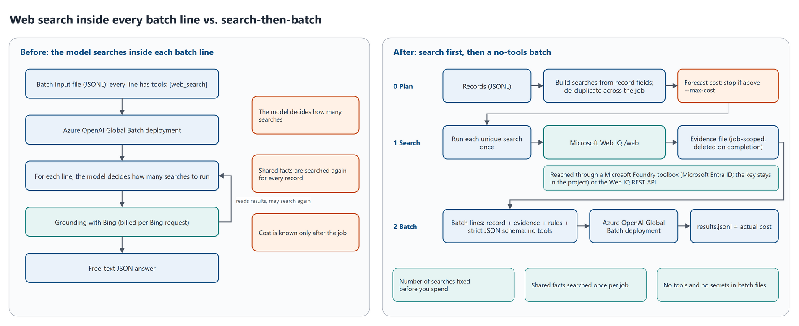

# Search then batch

**Lower-cost, web-grounded Azure OpenAI batch jobs with Microsoft Web IQ.**

Many teams check or enrich records in bulk with Azure OpenAI Global Batch, one JSONL line per record, each line telling the model to "use web search". Search usually becomes most of the bill, and the model decides how big it gets. This repository shows another way:

1. **Plan the searches in code** from each record's fields, de-duplicated across the job, and forecast the cost.
2. **Run each unique search once** with [Microsoft Web IQ](https://learn.microsoft.com/en-us/web-iq/overview), through a Microsoft Foundry toolbox (Microsoft Entra ID; the key stays in the project) or the Web IQ REST API.
3. **Submit a batch with no tools.** Each line carries its own evidence, written decision rules and a strict JSON schema; the model only judges.

It includes working Python code, a public sample with labeled answers, measured results, and guidance on cost, security, compliance and quality.

> This is an independent sample, not an official Microsoft project or a supported Microsoft product. The results below were priced with list prices retrieved on 31 October 2026; the code reads current list prices from the Azure Retail Prices API each time it runs. Measure on your own data before relying on any number here.



## Results on the sample

Twenty-three brand-ownership records, two facts each, on Global Batch, 31 October 2026 ([details](docs/09-results-on-the-sample.md), [raw results](results/2026-10-31/)):

| Design | Model | $ per 1,000 records | Search share of cost | Facts right (of 46) |
| --- | --- | --- | --- | --- |
| Model-driven web search (`web_search` tool in each line) | gpt-5.4-mini | $43.12 | 93% | 42 |
| Option 1: bounded web search (call cap, low effort, schema, budget) | gpt-5.4-mini | $40.33 | 88% | 42 |
| **Option 2: search-then-batch, lean plan** | gpt-5.4-mini | **$9.78** (-77%) | 81% | 44 |
| Option 2: search-then-batch, full plan | gpt-5.4-mini | $10.49 (-76%) | 84% | 44 |
| Model-driven web search | gpt-5.4 | $44.73 | 79% | 44 |
| **Option 2: search-then-batch, lean plan** | gpt-5.4 | **$14.08** (-69%) | 56% | 45 |

"Search-then-batch" is [option 2, two-stage with Web IQ](option-2-two-stage-web-iq/README.md); its runs are named `two-stage` in the result folders. Its **full** plan runs every search for every record; its **lean** plan skips the per-record brand search when the brand's name contains the owner's name, a business rule explained in [02](docs/02-the-search-then-batch-pattern.md#designing-the-searches). Percentages compare with model-driven web search on the same model.

Why it's cheaper:

- **Search price.** Web IQ is $7 per 1,000 calls, against $14 per 1,000 Bing requests for the built-in tool, at list prices ([Web IQ pricing](https://learn.microsoft.com/en-us/web-iq/resources/pricing), [Grounding with Bing pricing](https://www.microsoft.com/en-us/bing/apis)).
- **Search count.** It fell from 2.5-2.9 billed requests to 1.13 (lean) or 1.26 (full) planned calls per record, because shared facts are searched once per job.
- **Input size.** It's less than half, because trimmed evidence replaces the model's own search loop ([04](docs/04-cost-model.md)).

**Twenty-three records show the cost mechanics, not accuracy.** On this set, search-then-batch was no less accurate. [09](docs/09-results-on-the-sample.md#where-each-design-went-wrong) explains every miss, including a deliberate trap for the lean plan.

## Choose an option

Each option has its own folder, so you can go straight to the one you want. Each holds a README (what changes, the measured cost, benefits and drawbacks, the commands and the settings that matter), a step-by-step WALKTHROUGH that follows one record through the code, and the option's own code and command.

| Folder | Search | Runs on | Command | When to choose it |
| --- | --- | --- | --- | --- |
| [option-1-bounded-web-search/](option-1-bounded-web-search/README.md) | The built-in web search tool, capped at two calls with a search budget in the prompt | Global Batch | `bounded_web_search.py` | A change this week with no new service, when `analyze` shows the model making many searches per line |
| [option-2-two-stage-web-iq/](option-2-two-stage-web-iq/README.md) | Microsoft Web IQ, planned in code and run once per unique search, before a no-tools batch | Global Batch | `two_stage.py` | The lowest cost, when the searches can be built from each record's fields and the facts change slowly |
| [flex-web-search-and-web-iq/](flex-web-search-and-web-iq/README.md) | Either: web search (option 1's lines) or Web IQ (option 2's) | Flex processing (preview), one synchronous request per line | `flex_job.py` | Results in seconds per record, or a model without a Global Batch SKU, when a preview tier without an SLA is acceptable |

The code every option uses (the job runner, the Batch API, costs and live prices, settings, the sample workload) is in [shared/](shared/); checking answers and sharing results are in [evaluation/](evaluation/). Nothing needs installing beyond [requirements.txt](requirements.txt): each script finds `shared/` on its own.

## When to use it

Use it when:

- search is most of your batch cost (check with `analyze`, below);
- the searches can be built from each record's fields;
- the facts change slowly enough that hours-old evidence is fine;
- you can send the fields you search on to Web IQ, which is outside the Microsoft Data Protection Addendum and the EU Data Boundary ([06](docs/06-security-privacy-and-terms.md)).

Don't use it, or add a second pass, when the right search depends on what an earlier search found ([02](docs/02-the-search-then-batch-pattern.md#when-the-pattern-doesnt-fit)).

## Quick start

From the repository root:

```bash
python -m venv .venv
source .venv/bin/activate          # Windows: .venv\Scripts\activate
pip install -r requirements.txt
python -m pytest -q                # offline tests

# Forecast the sample: costs nothing, calls no model or search service
python option-2-two-stage-web-iq/two_stage.py plan samples/brand-owner/records.jsonl --plan lean --show-searches

# See what drives the cost of a batch job you already ran: your files stay local
python shared/analyze.py my-batch-output.jsonl --price-model gpt-5.4-mini
```

To run the sample end to end with option 2 you need a Web IQ resource, a Foundry project with a Web IQ connection, and a Global Batch deployment. [07 - Deploy and run](docs/07-deploy-and-run.md) walks through it:

```bash
python option-2-two-stage-web-iq/toolbox.py create --project-endpoint https://<resource>.services.ai.azure.com/api/projects/<project> \
    --name webiq-search --connection <web-iq-connection>
python option-2-two-stage-web-iq/two_stage.py run samples/brand-owner/records.jsonl --workdir runs/lean --plan lean \
    --toolbox-url "https://<resource>.services.ai.azure.com/api/projects/<project>/toolboxes/webiq-search/mcp?api-version=v1" \
    --base-url https://<resource>.openai.azure.com/openai/v1/ \
    --deployment <gpt-5.4-mini Global Batch deployment> --price-model gpt-5.4-mini --max-cost 1
python evaluation/evaluate.py runs/lean --labels samples/brand-owner/labels.jsonl
```

`run` stops before spending more if a forecast is above `--max-cost`, resumes if re-run after an interruption, and deletes its working files at the end ([job flow](diagrams/02-job-flow.png)). It's built to run unattended: it waits out throttling and a full batch quota, splits jobs above the batch file limits, and sends searches and lines that failed with errors that may pass again in up to three rounds. What it still can't answer is held and listed in `held-records.jsonl`, and every `run` ends with an exit code a scheduler can act on ([Run it unattended](docs/07-deploy-and-run.md#run-it-unattended)). Option 1 needs only the Global Batch deployment: see its [README](option-1-bounded-web-search/README.md#run-it).

**Prices and settings.** Forecasts and costs use list prices read live from the public [Azure Retail Prices API](https://learn.microsoft.com/en-us/rest/api/cost-management/retail-prices/azure-retail-prices) (no sign-in); `python shared/prices.py` shows them, and `--prices <file>` prices with a saved or negotiated table instead. A job saves the prices it started with in `prices-used.json`, so a resumed job is priced the same way. Every other tunable value (defaults, limits, retries, Web IQ and toolbox settings, and the names of the price meters) is in one file, [shared/settings.toml](shared/settings.toml); set `SEARCH_THEN_BATCH_SETTINGS` to use another copy.

## Documentation

Read in this order the first time:

| | Document | What's in it |
| --- | --- | --- |
| 1 | [01 - Why web search in batch costs more](docs/01-why-web-search-in-batch-costs-more.md) | How search is billed, what it looks like on the sample, how to measure your own job |
| 2 | [02 - The search-then-batch pattern](docs/02-the-search-then-batch-pattern.md) | The three stages, search and evidence design, the batch line, toolbox or REST, guardrails |
| 3 | [03 - Options compared](docs/03-options-compared.md) | Bounded search, Web IQ inside batch lines, synchronous calls, Flex processing, rejected alternatives, how to choose |
| 4 | [04 - Cost model](docs/04-cost-model.md) | Prices and sources, formulas, measured costs, where savings come from, forecast accuracy |
| 5 | [05 - Best practices](docs/05-best-practices.md) | A checklist: measuring, searches, evidence, prompts, spend, reliability, security, quality |
| 6 | [06 - Security, privacy and terms](docs/06-security-privacy-and-terms.md) | Identities and keys, where data goes, compliance boundaries, Web IQ storage terms, prompt injection |
| 7 | [07 - Deploy and run](docs/07-deploy-and-run.md) | Setup, roles, running the sample, running unattended and the exit codes, running at scale, troubleshooting |
| 8 | [08 - Evaluate quality](docs/08-evaluate-quality.md) | Labeled sets, the `evaluate` command, reading misses |
| 9 | [09 - Results on the sample](docs/09-results-on-the-sample.md) | Every measured number and every miss |
| 10 | [10 - Adapt it to your workload](docs/10-adapt-to-your-workload.md) | Writing your own workload class, rules and schema |
| | [FAQ](docs/faq.md), [Glossary](docs/glossary.md) | |

## Repository map

| Path | What it is |
| --- | --- |
| [option-1-bounded-web-search/](option-1-bounded-web-search/README.md) | Option 1: [README](option-1-bounded-web-search/README.md), [WALKTHROUGH](option-1-bounded-web-search/WALKTHROUGH.md), `bounded_web_search.py` (the command) and `web_search_lines.py` (one line with the capped web search tool) |
| [option-2-two-stage-web-iq/](option-2-two-stage-web-iq/README.md) | Option 2: [README](option-2-two-stage-web-iq/README.md), [WALKTHROUGH](option-2-two-stage-web-iq/WALKTHROUGH.md), `two_stage.py` (the command), `search_plan.py` (the search plan), `webiq.py` (stage 1: Web IQ through a Foundry toolbox or REST, rate-limited, retried, resumable), `two_stage_lines.py` (one no-tools line with its evidence) and `toolbox.py` (creates, tests and deletes the Foundry toolbox) |
| [flex-web-search-and-web-iq/](flex-web-search-and-web-iq/README.md) | Flex: [README](flex-web-search-and-web-iq/README.md), [WALKTHROUGH](flex-web-search-and-web-iq/WALKTHROUGH.md), `flex_job.py` (the command) and `flex.py` (each line as a synchronous Flex request, paced, retried and recorded in an attempt ledger, resumable) |
| [shared/pipeline.py](shared/pipeline.py) | The job runner behind every option's `plan`, `search`, `build` and `run`: automatic rounds, held records and exit codes |
| [shared/batch.py](shared/batch.py) | Split, upload, create (waiting while the quota is full), wait, collect usage, sort lines for another round, delete files |
| [shared/exits.py](shared/exits.py) | The exit codes every `run` ends with |
| [shared/cost.py](shared/cost.py), [shared/prices.py](shared/prices.py) | Forecasts and actual cost, at list prices read live from the Azure Retail Prices API; `python shared/prices.py` prints the table |
| [shared/settings.toml](shared/settings.toml) | Every tunable value in one file: defaults, limits, retries, Web IQ and toolbox settings, and the price meters to read |
| [shared/analyze.py](shared/analyze.py) | Cost drivers of an existing batch input or output file |
| [shared/workloads/brand_owner.py](shared/workloads/brand_owner.py) | The sample workload: searches, prompt, schema |
| [shared/cli.py](shared/cli.py), [shared/folders.py](shared/folders.py) | Command-line options shared by the three commands, and how shared code loads an option's modules |
| [evaluation/evaluate.py](evaluation/evaluate.py) | Accuracy against labeled answers |
| [evaluation/report.py](evaluation/report.py) | Copies shareable run files; refuses endpoints, paths and job IDs; removes personal-page URLs |
| [samples/brand-owner/](samples/brand-owner/) | 23 records and their labels with sources |
| [results/2026-10-31/](results/2026-10-31/) | The six measured runs and their evaluation |
| [diagrams/](diagrams/) | Architecture and flow diagrams (draw.io source and PNG) |
| [tests/](tests/) | Offline unit tests, priced with the 31 October 2026 table in [tests/fixtures/](tests/fixtures/) |
| [.github/workflows/tests.yml](.github/workflows/tests.yml) | Runs the offline tests and each option's `plan` on Python 3.10 and 3.12 for every push and pull request, then checks that every price meter in settings.toml still resolves (a warning, not a failure) |

## Important limits

- **Web IQ has no SLA, and isn't covered by the Data Protection Addendum or the EU Data Boundary** ([Web IQ FAQ](https://learn.microsoft.com/en-us/web-iq/resources/faq)).
- **Storing Web IQ content.** The terms restrict storing content. This sample keeps evidence only for a job's duration; confirm that fits your use with your legal team ([06](docs/06-security-privacy-and-terms.md#web-iq-terms-storing-content)).
- **Evidence age.** Evidence is minutes to hours old when the batch runs.
- **Skip rules.** The lean plan's skip rule is a business decision with a known blind spot (R10 in the sample).
- **Not tested:** Data Zone Batch, the Entra ID REST path, other models, a second pass for `insufficient_evidence` records, and jobs large enough to hit rate limits. Flex processing was checked live on 5 records only, not measured on the sample. The automatic rounds, split jobs, quota waits and exit codes are covered by offline tests only.

## Contributing

Contributions and suggestions are welcome; see [CONTRIBUTING.md](CONTRIBUTING.md). Report security issues privately, as [SECURITY.md](SECURITY.md) describes, not in public issues. For help, see [SUPPORT.md](SUPPORT.md).

## Trademarks

Microsoft, Azure and the other Microsoft product names in this repository are trademarks of the Microsoft group of companies. Their use here doesn't imply endorsement by Microsoft.

The sample data names real brands and companies only to check publicly reported facts about them; the names belong to their owners. "Glimmerbrook" and "Contoso Beverages Ltd" are fictional.

## License

[MIT](LICENSE)
