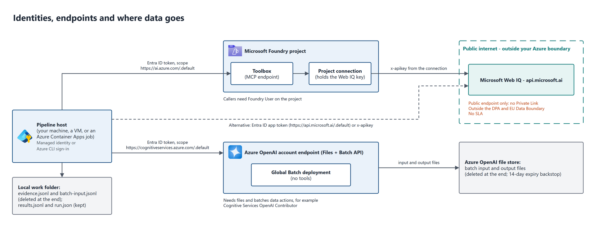

# 06 - Security, privacy and terms

Read this with your security, privacy and legal reviewers before you run your own records. It covers who calls what, where data goes and for how long, and which service terms apply. Statements about the services link to their documentation; statements about this sample's code link to the code.

*Source: [diagrams/04-identity-and-data-flow.drawio](../diagrams/04-identity-and-data-flow.drawio).*

## Where data goes

| Data | Goes to | Kept for | Controlled by |
| --- | --- | --- | --- |
| Record fields used in search queries (in the sample: brand, market, owner name) | Microsoft Web IQ, as query text | Web IQ logs queries for operations under the Microsoft Privacy Statement; Zero Query Logging can suppress query text on approved request ([Web IQ FAQ](https://learn.microsoft.com/en-us/web-iq/resources/faq#does-web-iq-log-api-queries)) | Your query templates in the workload ([brand_owner.py](../shared/workloads/brand_owner.py)) |
| Search results (Web IQ content) | `evidence.jsonl` in the job's work folder, then inside the batch input file | Until the job finishes; `run` deletes both ([pipeline.py](../shared/pipeline.py)). If a batch ends `failed`, `expired` or `cancelled`, both stay until a re-run completes the job, so re-run it or delete the work folder | `--keep-working-files` keeps them; don't use it beyond debugging |
| Batch input and output files | The Azure OpenAI file store of your Foundry resource | Until `run` deletes them after collecting results; created with a 14-day expiry as a backstop ([Batch](https://learn.microsoft.com/en-us/azure/foundry/openai/how-to/batch)) | [batch.py](../shared/batch.py) `submit`, `delete_files` |
| Model responses | Not stored by the service: every line sets `store: false` | - | [two_stage_lines.py](../option-2-two-stage-web-iq/two_stage_lines.py), [web_search_lines.py](../option-1-bounded-web-search/web_search_lines.py) |
| Decisions and citation URLs | `results.jsonl` and `metrics.jsonl` in the work folder (and `kept-lines.jsonl` while an incomplete batch is being resubmitted; deleted when the job finishes) | As long as you keep them | Your retention policy |
| Plan, forecasts, actual cost, timings | `run.json` (no endpoints, keys, paths or job IDs) | As long as you keep them | [report.py](../evaluation/report.py) checks before sharing |
| Endpoint and job IDs | `state.json` in the work folder | While the job runs; deleted when it finishes (unless `--keep-working-files`) | Excluded by [.gitignore](../.gitignore) |

Global Batch may process prompts and responses in any Azure region; Data Zone Batch keeps processing inside the US, EU or APAC data zone. Data at rest stays in the resource's geography in both cases ([Deployment types](https://learn.microsoft.com/en-us/azure/foundry/foundry-models/concepts/deployment-types)).

## Identities and keys

**Stage 1 through a Foundry toolbox (default).**

- The pipeline signs in with Microsoft Entra ID (Azure CLI or a managed identity) and gets a token for `https://ai.azure.com/.default` ([Toolbox](https://learn.microsoft.com/en-us/azure/foundry/agents/how-to/tools/toolbox)).
- The Web IQ key stays in the project connection. It never appears in this code, its files or the batch file.
- Callers need the **Foundry User** role on the project ([Toolbox prerequisites](https://learn.microsoft.com/en-us/azure/foundry/agents/how-to/tools/toolbox)).
- That role isn't a secret boundary. The built-in Foundry User definition returned by `az role definition list --name "Foundry User"` on 31 October 2026 (role ID `53ca6127-db72-4b80-b1b0-d745d6d5456d`, updated 16 September 2026) includes `Microsoft.CognitiveServices/accounts/projects/connections/listsecrets/action`. The published [role reference](https://learn.microsoft.com/en-us/azure/role-based-access-control/built-in-roles/ai-machine-learning#foundry-user) lists `accounts/listkeys/action` but didn't show `listsecrets` when we checked. Run the command yourself; if `listsecrets` is there, treat everyone who holds the role on the project as able to read the Web IQ key.

**Stage 1 through the Web IQ REST API.**

- With an API key in the `x-apikey` header, read from the `WEBIQ_API_KEY` environment variable (never written to disk by this code).
- Or with an app-only Microsoft Entra token for `https://api.microsoft.ai/.default`, from an app registration, managed identity or agent identity whose client ID is bound to your Web IQ AppID ([Web IQ authentication](https://learn.microsoft.com/en-us/web-iq/get-started/authentication), [Web IQ FAQ](https://learn.microsoft.com/en-us/web-iq/resources/faq#what-authentication-should-a-hosted-agent-use-managed-identity-or-agentid)).
- Web IQ recommends Entra ID over keys beyond prototypes. Web IQ doesn't use Azure RBAC: access is per AppID, so use separate AppIDs to separate workloads, quotas or policies ([Web IQ FAQ](https://learn.microsoft.com/en-us/web-iq/resources/faq#does-web-iq-use-azure-rbac-for-api-authorization)).
- This sample's Entra REST path is implemented but untested.

**Stage 2, the batch.**

- The pipeline gets a token for `https://cognitiveservices.azure.com/.default` and calls the Azure OpenAI endpoint ([batch.py](../shared/batch.py)).
- It needs file and batch data actions. **Cognitive Services OpenAI Contributor** includes them; **Cognitive Services OpenAI User** doesn't include file uploads ([Built-in roles](https://learn.microsoft.com/en-us/azure/role-based-access-control/built-in-roles/ai-machine-learning)).
- The batch lines carry no tools and no credentials.

**Don't put a key inside batch lines.** Referencing Web IQ as an MCP tool inside each batch line works only with the key in a header of every line, so the key sits in the uploaded file. Microsoft Entra access tokens aren't a substitute: they last 60-90 minutes by default ([Access tokens](https://learn.microsoft.com/en-us/entra/identity-platform/access-tokens#token-lifetime)), while a batch line can run hours after submission. [03](03-options-compared.md) covers that option.

## Network

Web IQ has a single public endpoint, `https://api.microsoft.ai/v3`. It doesn't support Private Link, private endpoints, VNet integration or IP allowlisting, and traffic from Azure isn't guaranteed to stay on the Microsoft network. Allow the `api.microsoft.ai` hostname in your egress controls ([Web IQ FAQ](https://learn.microsoft.com/en-us/web-iq/resources/faq#does-web-iq-support-private-link-private-endpoints-vnet-integration-or-ip-allowlisting)).

You can put Azure API Management in front of Web IQ for observability and governance ([Web IQ FAQ](https://learn.microsoft.com/en-us/web-iq/resources/faq#can-i-put-web-iq-behind-azure-api-management)). Point `--webiq-endpoint` at your gateway for the REST path. A gateway doesn't change the content-storage terms below.

## Compliance boundaries

- **Data Protection Addendum and EU Data Boundary.** Web IQ is excluded from the Microsoft Products and Services Data Protection Addendum and makes no EU Data Boundary or data-residency commitment. Microsoft and you act as independent data controllers for personal data processed under the Web IQ Terms of Use ([Web IQ FAQ](https://learn.microsoft.com/en-us/web-iq/resources/faq#is-web-iq-covered-by-the-azure-data-protection-addendum-or-eu-data-boundary)).
- **The built-in web search tool.** It uses Grounding with Bing. The Data Protection Addendum doesn't apply to data sent to it either, and that data flows outside your compliance and geo boundary ([Web search](https://learn.microsoft.com/en-us/azure/foundry/openai/how-to/web-search)). If you already accept that for built-in web search, Web IQ is the same category of decision. Review it anyway; the terms differ.
- **No service level agreement.** Web IQ has no SLA, RTO or RPO ([Web IQ FAQ](https://learn.microsoft.com/en-us/web-iq/resources/faq#does-web-iq-include-an-sla-rto-or-rpo-commitment)). In this design a Web IQ outage stops a job before it submits the batch, and a re-run retries only the failed searches.

## Personal data

- **Queries.** Web IQ doesn't detect or mask personal data in queries. If records may contain personal data, build queries only from non-personal fields, or scrub them first, for example with [Azure AI Language PII detection](https://learn.microsoft.com/en-us/azure/ai-services/language-service/personally-identifiable-information/overview) ([Web IQ FAQ](https://learn.microsoft.com/en-us/web-iq/resources/faq#does-web-iq-detect-or-mask-personal-data-in-queries)).
- **Results.** Results can name private individuals even when the query doesn't. Searches about small or owner-run businesses are the usual case. Classify the evidence and the outputs before you keep them.
- **The sample.** Its queries contain only brand and company names, and its decisions name only companies. Results still reached pages about people: for the two fictional records, searches returned a personal profile page, company-registry officer pages and local news, because nothing real matched. Before publishing, we removed those two records' findings and citations from the results (keeping their statuses), and `report` removes profile, social-media and officer-page URLs from every record ([results/README.md](../results/README.md)).

## Web IQ terms: storing content

The Web IQ Terms of Use generally prohibit copying, storing, caching or archiving Web IQ content, with three narrow exceptions summarized in the FAQ ([Can I cache or store Web IQ content?](https://learn.microsoft.com/en-us/web-iq/resources/faq#can-i-cache-or-store-web-iq-content)):

- per-end-user chat history for up to 30 days;
- transient processing "only as strictly necessary to complete a single logical request or workflow initiated by an LLM", deleted promptly when it completes;
- content stored as an integrated part of your own work product, as long as the work product isn't a substitute for the service, for example a database of content.

What this sample does:

- Evidence exists only for the duration of one job, and `run` deletes it at the end.
- Nothing is reused across jobs. A cross-job evidence cache would be a database of content.
- The kept output is your decision plus the citation URLs.

**What we can't tell you.** A batch job's searches are planned by code, not initiated by an LLM, and evidence can live for hours while a batch runs. Whether that fits the exceptions above is a question for your legal team, reading the current [Web IQ Terms of Use](https://www.microsoft.com/en-us/webiq/webiq-legal).

**Citations and display.** If you show model output based on Web IQ to people, the terms require attribution and a link to each source used, near the content ([Web IQ FAQ](https://learn.microsoft.com/en-us/web-iq/resources/faq#do-i-need-to-display-citations)). They also limit displayed content from any single source to the lesser of 200 characters or what the site owner allows ([Web IQ FAQ](https://learn.microsoft.com/en-us/web-iq/resources/faq#how-much-source-content-can-my-ai-agent-or-application-display)). The schema in this sample makes the model return a `citations` list for every fact, and a one-sentence finding rather than quoted page text; keep the citations with the decision.

## Retrieved content is untrusted input

Web IQ doesn't execute instructions found in pages, and doesn't guarantee to remove prompt-like text. Protection against indirect prompt injection belongs to the model and orchestration layer ([Web IQ FAQ](https://learn.microsoft.com/en-us/web-iq/resources/faq#does-web-iq-protect-an-llm-from-prompt-injection-in-retrieved-content)). The sample applies these layers ([two_stage_lines.py](../option-2-two-stage-web-iq/two_stage_lines.py), [brand_owner.py](../shared/workloads/brand_owner.py)):

- **Separation.** Evidence sits between `<<<EVIDENCE` and `EVIDENCE>>>` markers. The system prompt says it's untrusted data and that instructions inside it must be ignored.
- **No tools in stage 2.** A manipulated answer can't call anything, fetch anything or reach other records.
- **Strict JSON schema.** Statuses are an enum, so the output can only take the allowed shapes ([Structured outputs](https://learn.microsoft.com/en-us/azure/foundry/openai/how-to/structured-outputs)).
- **Output checks.** `evaluate` flags status values outside the enum. Treat a decision that cites a URL not present in its evidence as suspect.

For higher-risk workloads, add a document-attack check such as [Prompt Shields](https://learn.microsoft.com/en-us/azure/ai-services/content-safety/concepts/jailbreak-detection) on the evidence before stage 2. The sample doesn't.

## Checklist for a security review

- [ ] Which identity runs the job, and does it have only Foundry User on the project and batch rights on the resource?
- [ ] Who else holds Foundry User on the project (and so can read the Web IQ key)?
- [ ] Are keys kept out of files, and rotated between jobs, not during one?
- [ ] Is `api.microsoft.ai` allowed through egress controls, and is the lack of Private Link accepted?
- [ ] Do the query templates use only fields you're allowed to send outside the DPA?
- [ ] Has legal reviewed job-scoped evidence storage against the Web IQ Terms of Use?
- [ ] Are `state.json`, `evidence.jsonl` and `batch-input.jsonl` excluded from source control and backups?
- [ ] Is there a plan for a Web IQ outage (no SLA)?
