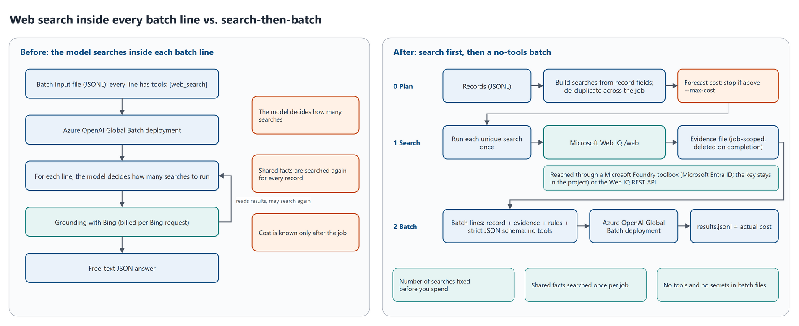

# Option 2: two-stage with Web IQ (search, then a no-tools batch)

Plan the searches in code, run each unique search once with [Microsoft Web IQ](https://learn.microsoft.com/en-us/web-iq/overview), then submit a batch with **no tools**: each line carries its own evidence, and the model only judges. This is the pattern the repository is about, and this folder holds its code.

| On the 23-record sample, Global Batch | Model-driven web search | Two-stage, lean plan | Two-stage, full plan |
| --- | --- | --- | --- |
| Cost per 1,000 records, gpt-5.4-mini | $43.12 | **$9.78 (-77%)** | $10.49 (-76%) |
| Cost per 1,000 records, gpt-5.4 | $44.73 | **$14.08 (-69%)** | Not run |
| Searches per record | 2.87 billed Bing requests (gpt-5.4-mini), decided by the model | 1.13 Web IQ calls, planned before the job | 1.26 Web IQ calls, planned before the job |
| Facts right (of 46), gpt-5.4-mini / gpt-5.4 | 42 / 44 | 44 / 45 | 44 / - |

Measured on 31 October 2026 at list prices ([09](../docs/09-results-on-the-sample.md), [raw results](../results/2026-10-31/)). Twenty-three records show the cost mechanics; they're too few to rank accuracy.



## How it works

1. **Plan** ([search_plan.py](search_plan.py)): build each record's searches from its own fields, share identical searches across the job, and forecast the cost. The **full** plan runs every search for every record; the **lean** plan skips the per-record brand search when the brand's name contains the owner's name, a business rule with a known blind spot ([02](../docs/02-the-search-then-batch-pattern.md#designing-the-searches)).
2. **Search** ([webiq.py](webiq.py)): run each unique search once, through a Microsoft Foundry toolbox (Microsoft Entra ID; the Web IQ key stays in the project connection) or the Web IQ REST API. Rate-limited, retried after the wait Web IQ asks for, and saved one by one, so an interrupted run never repeats a finished search. Searches that still fail run again in up to three rounds; the records that use a search that still fails are held, and the others go on.
3. **Batch** ([two_stage_lines.py](two_stage_lines.py), then the shared [batch.py](../shared/batch.py)): write no-tools lines with the evidence, written decision rules and a strict JSON schema; submit (split into several batch jobs above the file limits, and waiting while the quota is full, whether the region refuses the create or the job fails after validating), wait, send failed lines again in up to three rounds, collect and price; then delete the job's files and the local evidence.

`python two_stage.py run` does all three as one resumable command, and stops before spending more if a forecast is above `--max-cost` ([job flow](../diagrams/02-job-flow.png)). It's built to run unattended, and ends with an exit code a scheduler can act on ([below](#exit-codes)). [WALKTHROUGH.md](WALKTHROUGH.md) follows one record through every step.

## Benefits and drawbacks

Benefits:
- **The lowest cost**: Web IQ is $7 per 1,000 calls against $14 per 1,000 Bing requests, shared facts are searched once per job, and trimmed evidence replaces the model's own search loop ([04](../docs/04-cost-model.md)).
- **A forecast before anything is spent**: the searches are planned, so `plan` prints their number and the cost without calling any model or search service.
- **Written decision rules**: the prompt states how to judge the evidence, and every answer follows one schema.

Drawbacks:
- **Web IQ is a separate service**: it has no SLA, isn't covered by the Data Protection Addendum or the EU Data Boundary, and its terms restrict storing content ([06](../docs/06-security-privacy-and-terms.md)).
- **Search templates and decision rules decide quality**: a search the plan doesn't make can't inform the answer, and the lean plan's skip rule has a known blind spot (R10 in the sample).
- **Evidence is minutes to hours old** when the batch runs.
- **It doesn't fit multi-hop research**, where the right search depends on what an earlier one found; add a second pass with [option 1](../option-1-bounded-web-search/README.md) for those records ([02](../docs/02-the-search-then-batch-pattern.md#when-the-pattern-doesnt-fit)).

## What you need

- A Web IQ resource, a Foundry project with a Web IQ connection, and a Global Batch deployment, with the roles in [07 - Deploy and run](../docs/07-deploy-and-run.md#3-create-the-azure-resources).
- Python 3.10 or later and the packages in [requirements.txt](../requirements.txt), and the Azure CLI for `az login`.

## Run it

Once, from the repository root:

```bash
python -m venv .venv
source .venv/bin/activate          # Windows: .venv\Scripts\activate
pip install -r requirements.txt
az login
cd option-2-two-stage-web-iq
```

Then, from this folder:

```bash
# Forecast: costs nothing, calls no model or search service
python two_stage.py plan ../samples/brand-owner/records.jsonl --plan lean --show-searches

# Once: the toolbox that wraps your Web IQ connection; `create` prints the endpoint for --toolbox-url
python toolbox.py create --project-endpoint https://<resource>.services.ai.azure.com/api/projects/<project> \
    --name webiq-search --connection <web-iq-connection-name>
python toolbox.py test --project-endpoint https://<resource>.services.ai.azure.com/api/projects/<project> --name webiq-search

# A whole job; run the same command again to resume after an interruption
python two_stage.py run ../samples/brand-owner/records.jsonl --workdir runs/lean --plan lean \
    --toolbox-url "https://<resource>.services.ai.azure.com/api/projects/<project>/toolboxes/webiq-search/mcp?api-version=v1" \
    --base-url https://<resource>.openai.azure.com/openai/v1/ \
    --deployment <Global Batch deployment> --price-model gpt-5.4-mini --max-cost 1

# Check the answers, and copy the shareable files without endpoints, paths or job IDs
python ../evaluation/evaluate.py runs/lean --labels ../samples/brand-owner/labels.jsonl
python ../evaluation/report.py runs/lean --out ../results/my-run
```

Without a toolbox, set `WEBIQ_API_KEY` and replace `--toolbox-url ...` with `--via rest`. `--max-cost` is a guard on the forecast, not a billing cap. `two_stage.py search` and `two_stage.py build` run stage 1 and the line-writing on their own, to inspect them.

### Exit codes

`run` retries what retrying can fix on its own, holds what it still can't answer in `held-records.jsonl` (in the input format, to run again as a new job), and ends with one of these codes. `--no-auto-retry` turns the automatic rounds off. [Run it unattended](../docs/07-deploy-and-run.md#run-it-unattended) has the details.

| Code | Meaning |
| --- | --- |
| `0` | Done: every line was answered, or failed for good with an error retrying can't fix (listed in `results.jsonl`) |
| `1` | Needs a person: bad input, sign-in or permissions, a `--max-cost` forecast, a batch job that failed validation, or every record held because searches failed with an error such as 401 or 403. Fix it and run the same command again |
| `3` | Finished, with records held after the automatic rounds (their searches or lines still failed): run `held-records.jsonl` as a new job later |
| `75` | Still running, waiting for quota, or a create whose answer was lost couldn't be checked yet: run the same command again later |
| `130` | Interrupted with Ctrl+C: run the same command again to resume |

## Settings that matter

All in [shared/settings.toml](../shared/settings.toml). A command-line option overrides a value for one run.

| Setting | Line | Default |
| --- | --- | --- |
| `[defaults] plan` (`--plan`): lean or full | [85](../shared/settings.toml#L85) | `"lean"` |
| `[webiq] via` (`--via`): toolbox or rest | [101](../shared/settings.toml#L101) | `"toolbox"` |
| `[webiq] max_results` and `max_chars`: results per search, characters per result | [103](../shared/settings.toml#L103), [104](../shared/settings.toml#L104) | `5`, `1200` |
| `[webiq] qps` (`--qps`): stay under your Web IQ limit, 15 queries per second by default | [106](../shared/settings.toml#L106) | `5.0` |
| `[webiq] max_queries_per_record`: a safety cap on searches per run, per record (`--max-queries` sets an absolute cap) | [109](../shared/settings.toml#L109) | `3` |
| `[webiq] max_retry_after_seconds`: the longest wait Web IQ asks for that is waited out between attempts; a search asked to wait longer waits for the next round | [110](../shared/settings.toml#L110) | `600` |
| `[webiq] auto_rounds` and `round_waits_seconds`: rounds in all for searches that still fail with HTTP 408, 429, 5xx or a network error, and the pauses before rounds 2 and 3 | [112](../shared/settings.toml#L112), [113](../shared/settings.toml#L113) | `3`, `[60, 300]` |
| `[webiq] keepalive_seconds`: how long idle connections stay open between searches | [116](../shared/settings.toml#L116) | `120` |
| The Web IQ meter that prices the searches | [76](../shared/settings.toml#L76) | Microsoft Web IQ, Web Transactions, read live from the Azure Retail Prices API |
| `[batch]`: file limits and where a larger job is split, file expiry, polling and the stall warning, `--max-wait-minutes`, rounds, and the wait while the quota is full | [125](../shared/settings.toml#L125) | 200 MB and 100,000 lines (split at 180 MB), 14 days, every 60 s, after 120 min, no limit, 3 rounds, up to 24 hours |

## Files

| File | What it does |
| --- | --- |
| [WALKTHROUGH.md](WALKTHROUGH.md) | Every step, following one record, with the code behind it |
| [two_stage.py](two_stage.py) | The command: `plan`, `search`, `build` and `run` |
| [search_plan.py](search_plan.py) | Builds the search plan and shares identical searches across the job |
| [webiq.py](webiq.py) | Stage 1: Web IQ through a Foundry toolbox or REST, rate-limited, retried in automatic rounds, resumable |
| [two_stage_lines.py](two_stage_lines.py) | Writes one no-tools line: rules, evidence, record |
| [toolbox.py](toolbox.py) | Creates, tests and deletes the Foundry toolbox |
| [../shared/](../shared/) | The code every option uses: the job runner ([pipeline.py](../shared/pipeline.py)), the Batch API ([batch.py](../shared/batch.py)), forecasts and live prices ([cost.py](../shared/cost.py), [prices.py](../shared/prices.py)), the sample workload's searches, rules and schema ([workloads/brand_owner.py](../shared/workloads/brand_owner.py)) and [settings.toml](../shared/settings.toml) |

## Run stage 2 on Flex instead of Batch

Stage 1 stays the same: [flex-web-search-and-web-iq/](../flex-web-search-and-web-iq/README.md) runs `python flex_job.py run ... --design two-stage` from that folder.

## More

- [02 - The search-then-batch pattern](../docs/02-the-search-then-batch-pattern.md): the stages, search and evidence design, toolbox or REST, guardrails.
- [04 - Cost model](../docs/04-cost-model.md) and [05 - Best practices](../docs/05-best-practices.md).
- [08 - Evaluate quality](../docs/08-evaluate-quality.md) and [10 - Adapt it to your workload](../docs/10-adapt-to-your-workload.md).
